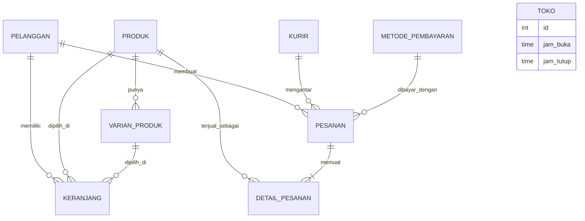

# PRD — Toko Online Kelompok 1 (Makanan & Minuman Siap Saji)

| | |
|---|---|
| Dokumen | Product Requirements Document + rencana kerja tim |
| Versi | **1.1** — 4 November 2026 (video ditiadakan; jadwal dipadatkan menjadi 7 hari) |
| Mata kuliah | Pemrograman Aplikasi Perangkat Bergerak (2010MWP0507) & Sistem Terdistribusi |
| Dosen | Ahsanun Naseh Khudori, S.Kom., M.Kom. |
| Tugas | Tugas Pengganti UTS (berkelompok), bobot 20% nilai akhir di masing-masing mata kuliah |
| Kelompok / domain | **Kelompok 1 — Makanan dan minuman siap saji** |
| Jalur backend | **A** (REST API Laravel + MySQL milik sendiri) |
| Target internal | **Siap kumpul pada Hari 7** sejak kickoff. Sisa waktu hingga tenggat resmi menjadi cadangan |
| Tenggat resmi | Sebelum Pertemuan 8, via LMS. Tanggal: `____` (isi) |
| Penilaian | Pertemuan 8: demo langsung 3 menit, tanya jawab 7 menit, tugas modifikasi 5 menit |

> **Cara memakai dokumen ini.** Setiap tugas di Bagian 8 punya ID (mis. `A2-04`). Salin tiap ID menjadi satu GitHub Issue dengan judul yang sama. Bila kontrak API (Bagian 6) berubah, ubah dokumen ini lewat PR (Bagian 9.4). Jadwal harian ada di Bagian 10.

---

## 1. Ringkasan dan Sasaran

### 1.1 Produk
Aplikasi toko online makanan dan minuman siap saji. Pembeli menelusuri menu, mengisi keranjang (dengan varian porsi, tingkat pedas, dan catatan per item), checkout dengan kurir wilayah internal, lalu membayar secara simulasi. Aplikasi terdiri atas dua komponen:

- **Backend**: REST API Laravel di atas MySQL.
- **Mobile**: aplikasi Flutter yang memakai paket `http`.

Satu pekerjaan dinilai dua kali: PAPB (kualitas Flutter, keadaan layar, penanganan galat) dan Sistem Terdistribusi (kontrak API, konsistensi data, ketahanan terhadap kegagalan).

### 1.2 Lima Aturan Emas
1. **Server adalah satu-satunya sumber kebenaran.** Harga, subtotal, ongkos kirim, total, dan ketersediaan dihitung di Laravel. Flutter hanya menampilkan.
2. **Checkout bersifat atomik.** Pengurangan stok, penyimpanan pesanan, dan pengosongan keranjang berada dalam satu transaksi. Gagal di tengah berarti tidak ada yang berubah.
3. **Kontrak API disiplin.** Dokumentasi, respons nyata, dan model Dart harus cocok.
4. **Lima jenis galat tampil berbeda** (sambungan, batas waktu, 422, 409, 500) dan tidak pernah membocorkan jejak teknis.
5. **Semua anggota paham seluruh kode.** Uji petik memberi nol pada Kriteria 9 bagi yang tidak bisa menjelaskan, dan nilai kelompok pada Kriteria 7 turun satu tingkat.

### 1.3 Target Skor dan Kunci Pencapaian
Target tim adalah **skor 4 pada semua kriteria**, dengan total maksimum 85 poin kelompok ditambah 15 poin individu per mata kuliah.

| Kriteria | Bobot PAPB / ST | Kunci untuk skor 4 | PIC utama |
|---|---|---|---|
| K1 Domain & skema | 8 / 10 | Atribut khas ada **dan** aturan jam buka ditegakkan **server**; entitas tambahan dirancang sendiri | A1 (skema), A2 (aturan) |
| K2 Katalog & CRUD | 10 / 5 | 4 operasi CRUD jalan; filter dan cari lewat server; produk habis ditandai dan tombol mati; pakai `builder` | A1 (API), A4 (UI) |
| K3 Keranjang & checkout | 12 / 8 | Alur penuh jalan; subtotal dan ongkir dari server; ongkir berubah saat kurir diganti; bayar simulasi lewat PATCH | A2 (API), A5 (UI) |
| K4 Kontrak & dokumentasi | 8 / **18** | 14 endpoint lengkap; pembungkus seragam; dokumen cocok dengan server; contoh nyata; Postman terlampir | PM (pembungkus), A3 (dokumen) |
| K5 Konsistensi & transaksi | 8 / **20** | Satu transaksi + `lockForUpdate`; rollback bersih; kunci idempoten; harga disalin ke detail | A2 |
| K6 Galat & ketahanan | 12 / 12 | 5 galat berbeda dan dapat diperagakan langsung saat demo; 422 per kolom; timeout + coba lagi; tanpa jejak teknis | PM (fondasi), semua pemilik halaman |
| K7 Keadaan & kualitas kode | **20** / 7 | 4 keadaan eksplisit per halaman; kosong ≠ galat; satu kelas layanan; tanpa jaringan di `build`; tanpa kode mati | PM (fondasi), A4, A5 |
| K8 Repo, README, dokumentasi | 7 / 5 | Struktur repo sesuai; README lengkap; seeder sekali jalan; ≥5 commit bermakna per anggota | PM |
| K9 Uji petik (individu) | 15 / 15 | Menjawab semua pertanyaan dan menyelesaikan modifikasi tanpa bantuan | **Semua** |

---

## 2. Lingkup

### 2.1 Dalam lingkup (P0 dan P1)
- 7 halaman Flutter: Katalog, Rincian Produk, Keranjang, Checkout, Rincian Pesanan, Riwayat Pesanan, Kelola Produk.
- 14 endpoint wajib (Bagian 6), ditambah 2 endpoint pendukung kecil (`/kategori`, `/metode-pembayaran`).
- Pembayaran simulasi dengan perubahan status pesanan, dan kurir/tarif internal di basis data.
- Aturan bisnis khas domain: checkout ditolak di luar jam buka.
- Dokumentasi API (PDF 6–10 halaman), koleksi Postman, dan README.
- **Lembar demo langsung** (Bagian 12.4). Video demo sudah ditiadakan, jadi seluruh bukti diperagakan langsung saat Pertemuan 8.

### 2.2 Di luar lingkup
- Payment gateway (Midtrans, Xendit, Stripe) dan API ekspedisi (RajaOngkir, JNE, SiCepat).
- Login JWT/OAuth 2.0 (Pertemuan 14, bukan tugas ini).
- Provider atau pustaka state management lain. Cukup `setState`, constructor, dan callback; tidak menambah nilai.
- Panel admin web. "Admin" hanya berperan lewat Postman untuk mengubah status lanjutan.
- Pengelolaan varian produk dari aplikasi. Varian hanya dari seeder.
- Upload gambar produk.
- Video demo (ditiadakan).

### 2.3 Ditunda (P2) karena jadwal 1 minggu
Tidak dikerjakan sebelum **semua P0 selesai** (Hari 5 malam):
- Pagination dan lazy load (nilai tambah Katalog).
- Pembatalan pesanan mengembalikan stok.
- Endpoint `GET /api/toko` dan spanduk "Toko tutup" di Flutter.
- GitHub Actions.

---

## 3. Domain Kelompok 1: Makanan dan Minuman Siap Saji

### 3.1 Atribut dan entitas khas (wajib)
| Kebutuhan dari dosen | Wujud di sistem kita |
|---|---|
| Varian porsi atau tingkat kepedasan | **Keduanya.** Tabel `varian_produk` (porsi: Reguler/Jumbo, tambahan harga) dan kolom `tingkat_pedas` per item keranjang/pesanan, hanya untuk produk dengan `bisa_pedas = true` |
| Catatan pesanan per item | Kolom `catatan` (maks. 200 karakter) pada item keranjang dan detail pesanan |
| Jam buka toko | Tabel `toko` (`jam_buka`, `jam_tutup`) dan aturan di checkout |

Dua kolom khas domain pada tabel `produk` (di luar 7 kolom inti): **`bisa_pedas`** (bool) dan **`waktu_persiapan_menit`** (int).

### 3.2 Aturan bisnis wajib
> **Checkout ditolak oleh server bila waktu sekarang (WIB) berada di luar `jam_buka`–`jam_tutup`.**
> Balasan: **409**, `message` jelas, misalnya *"Toko sedang tutup. Pesanan hanya dapat dibuat pukul 08.00–21.00 WIB."*, dan `data.alasan = "toko_tutup"`. Flutter menampilkan pesan itu di layar checkout tanpa pindah halaman.

Dua hal penting:
- **Flutter tidak boleh mematikan tombol checkout berdasarkan jam.** Penegakan harus terjadi di server. Kalau tombol dimatikan di Flutter, penolakan server tidak bisa didemokan dan penilaian jatuh ke skor 3 pada K1.
- Untuk demo, jam buka diubah langsung di tabel `toko` (atau via `tinker`), bukan dengan mengubah jam laptop. Pastikan jam buka mencakup waktu sesi Pertemuan 8, kecuali sedang memperagakan penolakan.

---

## 4. Arsitektur, Keputusan Desain, dan Pagar Pengaman

### 4.1 Pembagian tanggung jawab lapisan
| Lapisan | Tanggung jawab | Dilarang |
|---|---|---|
| MySQL (InnoDB) | Menyimpan produk, varian, keranjang, pesanan, detail pesanan, kurir, toko | Total sebagai satu-satunya sumber tanpa detail per item |
| Laravel | Validasi, subtotal, ongkir, pengurangan stok, perpindahan status, aturan jam buka | Mengembalikan HTML atau galat mentah basis data |
| Flutter | Menampilkan data, mengirim permintaan, mengelola keadaan layar, menampilkan galat | Menghitung total, memutuskan ketersediaan, menyimpan harga hasil hitung sendiri |

Tumpukan teknologi: Laravel (versi stabil terbaru yang disepakati tim), MySQL 8, Flutter stabil terbaru, paket `http`, paket `uuid` untuk kunci idempoten (disebut di README).

### 4.2 Keputusan Desain
Keputusan di bawah ini sudah dipilih agar tim tidak berdebat di tengah jalan. Ubah hanya lewat PR (Bagian 9.4).

| ID | Keputusan | Alasan |
|---|---|---|
| D-01 | Nama jalur endpoint **tidak diganti** (`/api/produk`, dst.) | Mengurangi risiko dokumentasi tidak cocok dengan kode |
| D-02 | Identitas pembeli lewat **dua token statis** (`Authorization: Bearer <token pelanggan>`), satu token untuk tiap pelanggan. Middleware `PelangganStatis` memetakan token ke `pelanggan_id`. Token salah atau kosong menghasilkan 401 | Pelanggan ke-2 diperlukan untuk memperagakan "dua pembeli berebut unit terakhir" |
| D-03 | Pembungkus: `status`, `code` (**string**, mengikuti contoh PDF), `message`, `data`, dan `errors` (khusus 422). Respons gagal selalu memuat `data` (null atau rincian) | Satu fungsi di Flutter cukup untuk membaca semua respons |
| D-04 | Jam tutup → **409** dengan `data.alasan = "toko_tutup"` | 409 berarti "bertentangan dengan keadaan server", dan Flutter sudah dipetakan menampilkan pesan server tanpa pindah halaman |
| D-05 | Checkout dengan keranjang kosong → 409 | Sama dengan D-04 |
| D-06 | **Ringkasan checkout dihitung server** lewat `GET /api/keranjang?kurir_id=N`, yang mengembalikan `ringkasan.subtotal`, `ongkos_kirim`, dan `total`. Tanpa `kurir_id`, dua nilai terakhir bernilai `null` | Menjumlah `subtotal + tarif` di Dart termasuk "menghitung total" yang dilarang |
| D-07 | Penambahan ke keranjang **digabung** bila kombinasi (produk, varian, tingkat pedas, catatan) identik; selain itu menjadi baris baru | Memenuhi "tidak membuat baris kedua" tanpa merusak varian dan catatan |
| D-08 | Harga disalin ke `detail_pesanan` (`harga_satuan`, `nama_produk`, `varian_nama`) | Pesanan lama tidak berubah saat harga produk berubah |
| D-09 | Produk memakai **soft delete**. `DELETE` → 409 bila produk ada pada pesanan yang belum `selesai`/`dibatalkan`. Item keranjang produk itu ikut dibersihkan | Riwayat pesanan tetap utuh |
| D-10 | **Idempotensi**: unik per (`pelanggan_id`, `kunci_idempoten`). Kunci yang sama mengembalikan pesanan yang sama dengan **201**. Pengecekan ulang di dalam transaksi, setelah baris pelanggan dikunci | Retry aman, dan pembuatan pesanan paralel oleh pembeli yang sama terserialisasi |
| D-11 | Status awal pesanan `menunggu_pembayaran` untuk kedua metode. Tombol bayar → `menunggu_konfirmasi`. Langkah berikutnya diubah "admin" via Postman | Sesuai Bagian 1 PDF |
| D-12 | Gangguan simulasi diatur lewat `.env`: `SIMULASI_GALAT_500=true` (membuat `GET /api/produk` melempar exception) dan `SIMULASI_LAMBAT_DETIK=12` (menunda respons agar timeout 10 detik terpicu). Hanya aktif bila `APP_ENV=local`. **Tidak ada route baru** | Memunculkan 500 dan timeout secara deterministik saat demo langsung, tanpa endpoint yang tak terdokumentasi |
| D-13 | Zona waktu `Asia/Jakarta`. Jam buka dibaca dari tabel `toko` | Hindari bug UTC vs WIB |
| D-14 (P2, ditunda) | `dibatalkan` mengembalikan stok dalam satu transaksi | Konsistensi data |
| D-15 (P2, ditunda) | Pagination `?halaman=&per_halaman=` dengan `meta` untuk lazy load | Nilai tambah Katalog |

### 4.3 Pagar Pengaman (cek wajib pada setiap code review)
1. Tidak ada operasi aritmetika pada nilai uang di Dart (harga, subtotal, ongkir, total).
2. Tidak ada pemanggilan HTTP di dalam widget atau metode `build`. Semuanya lewat `LayananApi`, dan panggilan awal di `initState` atau `FutureBuilder`.
3. Tidak ada `e.toString()` yang tampil ke pengguna.
4. Tidak ada blok `catch` kosong.
5. Tidak ada satu pesan galat yang sama untuk semua jenis galat.
6. Laravel tidak pernah membalas HTML atau pesan galat mentah basis data (paksa JSON, tangani semua exception).
7. Setiap pemanggilan punya `.timeout(...)`, dan timeout tampil sebagai galat di layar.
8. Daftar produk memakai `ListView.builder` atau `GridView.builder`.
9. Filter kategori dan pencarian mengirim ulang permintaan ke server.
10. Tidak ada `print`/`debugPrint` sisa, tidak ada kode mati, dan tidak ada **fixture sementara** yang tertinggal.
11. `.env` tidak pernah di-commit, hanya `.env.example`.
12. Kode hasil bantuan AI dicatat di PR dan README, dan penulisnya sanggup menjelaskan setiap barisnya.

---

## 5. Model Data



| Tabel | Kolom utama | Catatan |
|---|---|---|
| `produk` | `id`, `nama`, `harga` (int rupiah), `kategori`, `stok` (int ≥ 0), `tersedia` (bool), `deskripsi` (**nullable**), **`bisa_pedas`**, **`waktu_persiapan_menit`**, `deleted_at` | 7 kolom inti + 2 kolom khas. `stok` dan `tersedia` terpisah |
| `varian_produk` | `id`, `produk_id`, `nama` (Reguler/Jumbo/Large), `tambahan_harga`, `aktif` | Entitas khas domain. Stok tetap per produk (bukan per varian) |
| `keranjang` | `id`, `pelanggan_id`, `produk_id`, `varian_id` (nullable), `jumlah`, `tingkat_pedas` (nullable), `catatan` (nullable, ≤200) | Penggabungan baris dijaga di aplikasi (D-07) |
| `pesanan` | `id`, `nomor_pesanan` (unik, mis. `TKO1-20261104-0007`), `pelanggan_id`, `kurir_id`, `metode_pembayaran_id`, `nama_penerima`, `alamat_penerima`, `subtotal`, `ongkos_kirim`, `total`, `status`, `kunci_idempoten`, timestamps | **Unik** (`pelanggan_id`, `kunci_idempoten`) |
| `detail_pesanan` | `id`, `pesanan_id`, `produk_id`, `nama_produk`, `varian_nama`, `harga_dasar`, `tambahan_harga`, `harga_satuan`, `jumlah`, `subtotal`, `tingkat_pedas`, `catatan` | **Snapshot** saat pembelian |
| `kurir` | `id`, `nama`, `wilayah`, `tarif`, `aktif` | Minimal 3 baris dengan tarif berbeda |
| `metode_pembayaran` | `id`, `kode` (`tunai_di_tempat`, `transfer_manual`), `nama`, `aktif` | |
| `toko` | `id`, `nama`, `jam_buka`, `jam_tutup` | Satu baris |
| `pelanggan` | `id`, `nama`, `token` | Dua baris (D-02) |

Semua tabel memakai mesin InnoDB (wajib untuk transaksi dan `lockForUpdate`).

---

## 6. Kontrak API

### 6.1 Pembungkus respons
Sukses:
```json
{ "status": "sukses", "code": "200", "message": "Daftar produk berhasil diambil", "data": [ ... ] }
```
Gagal (validasi):
```json
{ "status": "gagal", "code": "422", "message": "Data yang dikirim tidak lengkap",
  "data": null, "errors": { "alamat_penerima": ["Alamat penerima wajib diisi"] } }
```
Gagal (stok, 409):
```json
{ "status": "gagal", "code": "409", "message": "Stok tidak mencukupi untuk 1 item",
  "data": { "alasan": "stok_kurang",
            "item_kurang": [ { "produk_id": 6, "nama": "Rawon Daging", "diminta": 5, "tersedia": 3 } ] } }
```
Gagal (jam tutup, 409):
```json
{ "status": "gagal", "code": "409",
  "message": "Toko sedang tutup. Pesanan hanya dapat dibuat pukul 08.00–21.00 WIB.",
  "data": { "alasan": "toko_tutup", "jam_buka": "08:00", "jam_tutup": "21:00" } }
```

### 6.2 Kode status dan perlakuan di Flutter
| Kode | Dipakai ketika | Perlakuan Flutter |
|---|---|---|
| 200 | Baca/ubah/hapus berhasil | Tampilkan data |
| 201 | Data baru dibuat | Pindah ke halaman hasil (mis. rincian pesanan) |
| 401 | Token statis salah/kosong | Pesan umum "akses ditolak" (galat umum) |
| 404 | Sumber daya tidak ada | **Keadaan kosong**, bukan dialog galat teknis |
| 409 | Bertentangan dengan keadaan server (stok kurang, jam tutup, transisi status tidak sah, produk masih dipakai) | Tampilkan `message` server di layar yang sedang dibuka; tolak lanjut |
| 422 | Validasi gagal | Pesan per kolom dari `errors`, di bawah kolom terkait |
| 500 | Galat server | Pesan umum + tombol coba lagi, tanpa jejak galat |

### 6.3 Daftar endpoint
| Metode & jalur | Fungsi | Sukses | Gagal | Pemilik |
|---|---|---|---|---|
| `GET /api/produk` | Daftar produk. Query `?kategori=`, `?cari=` | 200 (kosong tetap 200, `data: []`) | — | A1 |
| `GET /api/produk/{id}` | Rincian + varian | 200 | 404 | A1 |
| `POST /api/produk` | Tambah produk | 201 | 422 | A1 |
| `PUT /api/produk/{id}` | Ubah produk | 200 | 404, 422 | A1 |
| `DELETE /api/produk/{id}` | Hapus (soft delete) | 200 | 404, 409 (dipakai pesanan aktif) | A1 |
| `GET /api/keranjang` | Isi keranjang + `jumlah_item` + `ringkasan`. Query `?kurir_id=` | 200 (kosong: `items: []`) | 422 (kurir tak valid) | A2 |
| `POST /api/keranjang` | Tambah item: `produk_id`, `jumlah`, `varian_id?`, `tingkat_pedas?`, `catatan?` | 201 (baru maupun digabung) | 422, 409 (stok kurang atau produk tak tersedia) | A2 |
| `PUT /api/keranjang/{id}` | Ubah jumlah | 200 | 404, 422 (jumlah ≤ 0), 409 (stok) | A2 |
| `DELETE /api/keranjang/{id}` | Hapus item | 200 | 404 | A2 |
| `GET /api/kurir` | Kurir/wilayah + tarif | 200 | — | A3 |
| `POST /api/checkout` | Buat pesanan. **Wajib** header `X-Kunci-Idempoten` | 201 | 422, 409 (stok, jam tutup, keranjang kosong) | A2 |
| `GET /api/pesanan` | Riwayat, terbaru dahulu | 200 (kosong tetap 200) | — | A3 |
| `GET /api/pesanan/{id}` | Rincian + item (harga saat beli) | 200 | 404 | A3 |
| `PATCH /api/pesanan/{id}/status` | Ubah status (hanya transisi sah) | 200 | 404, 409 (transisi tak sah), 422 (nilai status tak dikenal) | A3 |
| *(tambahan)* `GET /api/kategori` | Daftar kategori untuk chip filter | 200 | — | A1 |
| *(tambahan)* `GET /api/metode-pembayaran` | Daftar metode simulasi | 200 | — | A3 |
| *(P2, ditunda)* `GET /api/toko` | Nama + jam buka untuk spanduk info | 200 | — | A3 |

Dua endpoint tambahan yang dikerjakan **wajib masuk dokumen PDF**, agar tidak dinilai sebagai "endpoint di kode yang tidak terdokumentasi".

### 6.4 Objek produk
```json
{
  "id": 1, "nama": "Nasi Goreng Spesial", "harga": 25000, "kategori": "Makanan",
  "stok": 30, "tersedia": true, "deskripsi": null,
  "bisa_pedas": true, "waktu_persiapan_menit": 15,
  "varian": [ { "id": 1, "nama": "Reguler", "tambahan_harga": 0 },
              { "id": 2, "nama": "Jumbo",   "tambahan_harga": 8000 } ]
}
```
`deskripsi` boleh `null`, dan model Dart wajib menanganinya.

### 6.5 Respons `GET /api/keranjang?kurir_id=2`
```json
{ "status": "sukses", "code": "200", "message": "Isi keranjang berhasil diambil",
  "data": {
    "items": [ { "id": 12, "produk_id": 1, "nama": "Nasi Goreng Spesial",
                 "varian": { "id": 2, "nama": "Jumbo", "tambahan_harga": 8000 },
                 "tingkat_pedas": "pedas", "catatan": "Tanpa bawang goreng",
                 "harga_satuan": 33000, "jumlah": 2, "subtotal": 66000 } ],
    "jumlah_item": 2,
    "ringkasan": { "subtotal": 66000, "ongkos_kirim": 10000, "total": 76000 } } }
```
Nilai `tingkat_pedas`: `tidak_pedas`, `sedang`, `pedas`, `sangat_pedas`. Validasi: produk dengan `bisa_pedas = false` yang dikirimi `tingkat_pedas` → 422.

### 6.6 Alur `POST /api/checkout`
Permintaan:
```http
POST /api/checkout
X-Kunci-Idempoten: 3f1c...(uuid)
Authorization: Bearer <token pelanggan>
{ "nama_penerima": "Budi Santoso", "alamat_penerima": "Jl. Soepraoen No. 10, Malang",
  "kurir_id": 2, "metode_pembayaran": "transfer_manual" }
```
Langkah server (urutan ini **wajib**):
1. Middleware token → `pelanggan_id`.
2. Validasi header dan body → 422 (header kosong juga 422).
3. **Jalur cepat idempotensi**: bila sudah ada pesanan untuk (pelanggan, kunci) → balas pesanan itu dengan 201.
4. **Cek jam buka** (waktu WIB) → di luar jam: 409 `toko_tutup`.
5. **Mulai transaksi**:
   - a. Kunci baris pelanggan (`lockForUpdate`) untuk menserialisasi checkout per pembeli.
   - b. Cek ulang kunci idempoten.
   - c. Baca keranjang (kosong → 409).
   - d. Kunci baris produk berurutan menurut `id` (`lockForUpdate`) agar tidak deadlock.
   - e. Cek `tersedia` dan stok. Bila ada yang kurang, kumpulkan daftar, rollback penuh, balas 409 `stok_kurang`.
   - f. Hitung `harga_satuan = produk.harga + varian.tambahan_harga`, subtotal, ongkir (`kurir.tarif`), dan total **di server**.
   - g. Simpan `pesanan` dan `detail_pesanan` (salin harga).
   - h. Kurangi stok.
   - i. Hapus item keranjang. Commit.
6. Balas **201** + `nomor_pesanan`. Bila balasan tidak sampai ke klien, klien mengulang dengan kunci sama, dan langkah 3 mengembalikan pesanan yang sama.

Balasan 201:
```json
{ "status": "sukses", "code": "201", "message": "Pesanan berhasil dibuat",
  "data": { "id": 7, "nomor_pesanan": "TKO1-20261104-0007", "status": "menunggu_pembayaran",
            "subtotal": 66000, "ongkos_kirim": 10000, "total": 76000,
            "metode_pembayaran": "transfer_manual" } }
```

### 6.7 Status pesanan
| Dari | Transisi sah |
|---|---|
| `menunggu_pembayaran` | `menunggu_konfirmasi`, `dibatalkan` |
| `menunggu_konfirmasi` | `dibayar`, `dibatalkan` |
| `dibayar` | `diproses` |
| `diproses` | `dikirim` |
| `dikirim` | `selesai` |
| `selesai`, `dibatalkan` | *(final)* |

Transisi di luar tabel → **409**. Nilai status yang tidak dikenal → **422**.

---

## 7. Spesifikasi Aplikasi Flutter

### 7.1 Halaman wajib
| Halaman (kelas) | Endpoint | Isi wajib | Navigasi | PIC |
|---|---|---|---|---|
| Katalog (`HalamanKatalog`) | `GET /produk`, `/kategori`, `/keranjang` (lencana) | `ListView/GridView.builder`; chip kategori dan pencarian **lewat server** (debounce ±400 ms, P1); penanda habis dan tombol tambah mati; ikon keranjang dengan lencana `jumlah_item` dari server | → Rincian; → Keranjang; → Riwayat; → Kelola Produk | A4 |
| Rincian Produk (`HalamanRincianProduk`) | `GET /produk/{id}`, `POST /keranjang` | Semua atribut termasuk `bisa_pedas` dan waktu persiapan; pilih varian porsi, tingkat pedas, catatan; pemilih jumlah **tidak dibatasi stok dari sisi Flutter** (server yang memutuskan, sehingga 409 bisa didemokan) | ← Katalog; → Keranjang setelah sukses | A4 |
| Keranjang (`HalamanKeranjang`) | `GET/PUT/DELETE /keranjang` | Item (varian, pedas, catatan), ubah jumlah, hapus, **subtotal dari server**; keadaan kosong ramah dengan tombol ke katalog; pesan 409 dari server | → Checkout; → Katalog bila kosong | A5 |
| Checkout (`HalamanCheckout`) | `GET /kurir`, `/metode-pembayaran`, `/keranjang?kurir_id=`, `POST /checkout` | `Form` + validator berbahasa Indonesia; pemilih kurir dan metode; ringkasan (subtotal + ongkir + total dari server) yang berubah saat kurir diganti; tombol mati selama permintaan; kunci idempoten (7.4); 422 per kolom; 409 di layar yang sama | → Rincian Pesanan setelah 201 (`pushReplacement`); tetap di tempat saat 409/422 | A5 |
| Rincian Pesanan (`HalamanRincianPesanan`) | `GET /pesanan/{id}`, `PATCH /pesanan/{id}/status` | Nomor, status, item + harga saat beli, total, metode; tombol **Bayar (simulasi)** memanggil PATCH ke `menunggu_konfirmasi` | → Katalog dengan tumpukan dibersihkan (`pushAndRemoveUntil`) | A5 |
| Riwayat Pesanan (`HalamanRiwayatPesanan`) | `GET /pesanan` | Daftar terbaru dahulu + status; keadaan kosong | → Rincian Pesanan | A4 |
| Kelola Produk (`HalamanKelolaProduk` + `FormProduk`) | CRUD `/produk` | Tambah, ubah, hapus (dialog konfirmasi sebelum kirim); daftar menyegarkan diri setelah tiap operasi sukses; 422 tampil per kolom; 409 hapus tampil dari server | → Form; kembali dengan hasil berhasil/batal | A4 |

### 7.2 Empat keadaan layar
Setiap halaman yang memanggil API memakai enum berikut secara eksplisit:
```dart
enum KeadaanMuat { memuat, berhasil, kosong, galat }
```
| Keadaan | Tampil |
|---|---|
| `memuat` | Indikator muat, tombol aksi mati |
| `berhasil` | Data |
| `kosong` | Keterangan + saran langkah berikutnya (bukan galat) |
| `galat` | Pesan sesuai jenis + tombol **coba lagi** |

Pengecekan `if (!mounted) return;` wajib sebelum setiap `setState` setelah `await` (jawaban uji petik A2).

### 7.3 Matriks penanganan galat
`LayananApi` melempar **exception bertipe**. Widget memetakan tiap tipe ke tampilan yang berbeda:

| Jenis | Cara memunculkan saat demo | Exception Dart | Tampilan |
|---|---|---|---|
| Tanpa sambungan | Matikan `php artisan serve` | `GalatSambungan` | "Sambungan ke server gagal" + coba lagi |
| Batas waktu | `SIMULASI_LAMBAT_DETIK=12` (atau mode pesawat) | `GalatBatasWaktu` | "Server tidak membalas" + coba lagi |
| 422 | Alamat dikosongkan | `GalatValidasi(errors)` | Pesan **di bawah tiap kolom** |
| 409 | Jumlah melebihi stok, atau checkout saat toko tutup | `GalatBentrok(pesan, data)` | Pesan dari server di layar yang sama, tanpa pindah halaman |
| 500 | `SIMULASI_GALAT_500=true` | `GalatServer` | Pesan umum + coba lagi, tanpa jejak |
| 404 | Sumber daya tidak ada | `GalatTidakDitemukan` | Keadaan **kosong** |
| 401 | Token salah | `GalatUmum` | Pesan umum |

Aksi tulis (tambah, ubah, hapus, checkout) menampilkan 409/422 **secara inline**. Pemuatan data yang gagal menampilkan layar galat penuh dengan coba lagi.

### 7.4 Kunci idempoten di checkout
- Kunci (UUID) dibuat **sekali per kunjungan** `HalamanCheckout` (di `initState`).
- Tombol **coba lagi** setelah galat sambungan atau timeout memakai **kunci yang sama**.
- Kunjungan baru ke halaman checkout membuat kunci baru.
- Flag `_sedangKirim` di-set **sebelum** `await` dan dipakai mematikan tombol, supaya satu ketukan tidak menjadi dua pesanan.

### 7.5 Struktur `lib/` (konsisten, bahasa Indonesia untuk istilah domain)
```
lib/
  main.dart
  konfigurasi/konfigurasi.dart          # const baseUrl = 'http://10.0.2.2:8000/api'
  model/                                # produk.dart, varian_produk.dart, item_keranjang.dart,
                                        # ringkasan_keranjang.dart, kurir.dart, metode_pembayaran.dart,
                                        # pesanan.dart, detail_pesanan.dart
  layanan/layanan_api.dart              # SATU kelas; semua pemanggilan HTTP; _kirim() + timeout + header token
  layanan/galat_api.dart                # exception bertipe
  umum/keadaan_muat.dart, format_rupiah.dart
  halaman/halaman_katalog.dart, ...     # satu berkas per halaman
  widget/kartu_produk.dart, tampilan_muat.dart, tampilan_kosong.dart, tampilan_galat.dart
```
Aturan tambahan:
- Token statis hanya diatur di **satu tempat** (`LayananApi._header()`), supaya penggantian ke login pada Pertemuan 14 cukup satu berkas.
- `AndroidManifest.xml` utama harus berisi `android:usesCleartextTraffic="true"` dan izin `INTERNET`. Tanpa itu, `http://10.0.2.2` diblokir di Android modern.
- Alamat emulator: `http://10.0.2.2:8000/api`. Perangkat fisik memakai IP LAN laptop dan `php artisan serve --host=0.0.0.0`.

---

## 8. Pembagian Kerja Tim

### 8.1 Struktur tim
Tim: **PM + 5 anggota = 6 orang**. Bila ternyata hanya 5 orang termasuk PM, gabungkan peran A3 ke PM dan A1.

| Kode | Nama | Peran | Kriteria utama | Kategori uji petik (utama) |
|---|---|---|---|---|
| **PM** | `[nama PM]` | Project Manager + fondasi backend dan Flutter + integrasi harian + README | K4 (pembungkus), K6, K7, K8 | A, B |
| **A1** | `[nama]` | Backend: basis data, seeder, Produk | K1, K2 | D, B |
| **A2** | `[nama]` | Backend: Keranjang, Checkout, transaksi | K3, K5, K1 (aturan jam) | C, D |
| **A3** | `[nama]` | Backend: Pesanan, Kurir, status, **dokumen API + Postman** | K4, K3 (status) | B, D |
| **A4** | `[nama]` | Flutter: Katalog, Rincian Produk, Kelola Produk, Riwayat | K2, K7 | A |
| **A5** | `[nama]` | Flutter: Keranjang, Checkout, Rincian Pesanan | K3, K6, K7 | A, C |

Target commit: **≥ 6 commit bermakna per orang** (minimum resmi 5), tersebar pada **minimal 4 hari berbeda**. Satu commit raksasa di akhir dinilai bukti pekerjaan tidak dibagi.

Kolom **Hari** pada tabel tugas mengacu ke jadwal Bagian 10. Ukuran tugas: **S** ≤ 2 jam, **M** ½ hari, **L** 1–1,5 hari. Prioritas: **P0** wajib untuk skor 4, **P1** polish, **P2** ditunda (Bagian 2.3).

### 8.2 Tugas PM
| ID | Tugas | Prio | Ukr | Hari |
|---|---|---|---|---|
| PM-01 | Buat repo GitHub (susunan `backend/`, `mobile/`, `docs/`, `README.md`), `.gitignore`, branch protection, template PR/Issue, board, label; undang 5 anggota **dan dosen** bila privat. **Dalam 2 jam pertama**, inisialisasi proyek Laravel dan Flutter kosong lalu push, agar semua orang bisa mulai | P0 | S | 1 |
| PM-02 | **Skeleton Laravel**: koneksi MySQL, timezone, `.env.example`, middleware `ForceJson` dan `PelangganStatis`, helper pembungkus respons, handler exception global (404/409/422/500 → pembungkus; 500 tanpa jejak), `routes/api.php` lengkap + controller kosong untuk tiap endpoint | P0 | L | 1 |
| PM-03 | **Inti Flutter**: `Konfigurasi`, `LayananApi._kirim()` (timeout 10 dtk, header token, baca pembungkus, lempar exception bertipe), `galat_api.dart`, `KeadaanMuat`, rute navigasi, setelan cleartext, uji sambung ke `10.0.2.2`. *(Widget bersama dan `format_rupiah` dikerjakan A4-01)* | P0 | M | 1–2 |
| PM-04 | Kickoff baca PRD bersama (30 menit), lalu finalisasi dan bekukan **Kontrak API v1** (Bagian 6) bersama A1–A5 (**contract freeze**) | P0 | S | 1 |
| PM-05 | Middleware **gangguan simulasi** (D-12): `SIMULASI_GALAT_500`, `SIMULASI_LAMBAT_DETIK` | P0 | S | 4 |
| PM-06 | Review PR semua anggota (**hari yang sama**), kelola board, stand-up harian, **integrasi malam**: `migrate:fresh --seed` + smoke test alur terbaru | P0 | M | 1–7 |
| PM-07 | README (Bagian 12.2) lengkap dengan catatan bantuan AI dan pustaka pihak ketiga | P0 | M | 6 |
| PM-08 | **Lembar demo langsung** (Bagian 12.4) dan latihan satu kali | P0 | S | 6 |
| PM-09 | Fasilitasi **simulasi uji petik** (Lampiran B) | P0 | M | 7 |
| PM-10 | Audit pagar pengaman (`grep` aritmetika uang di Dart, `print(`, HTTP di `build`, `catch` kosong, `toString()`, fixture sisa) | P1 | S | 6 |
| PM-11 | Pemeriksaan akhir (Bagian 11.3), pastikan **6 orang** mengumpulkan di LMS, nama PDF benar | P0 | S | 7 |

### 8.3 Tugas A1 — Backend: Basis Data & Produk
| ID | Tugas | Prio | Ukr | Hari |
|---|---|---|---|---|
| A1-01 | **Semua migrasi** (Bagian 5) + FK + indeks + unik `(pelanggan_id, kunci_idempoten)`. *Penghambat pertama: push sebelum malam Hari 1* | P0 | M | 1 |
| A1-02 | Model Eloquent + relasi + `SoftDeletes` + `casts` | P0 | M | 1 |
| A1-03 | **Seeder** produk + varian (Lampiran A) dan `DatabaseSeeder` yang memanggil seluruh seeder; `php artisan migrate --seed` jalan sekali eksekusi | P0 | M | 2 |
| A1-04 | `GET /api/produk` (filter `kategori`, `cari`, kosong tetap 200, eager-load varian) dan `GET /api/produk/{id}` (404) | P0 | M | 2 |
| A1-05 | `POST` dan `PUT /api/produk` + `FormRequest` (pesan bahasa Indonesia; 201/200/422/404) | P0 | M | 3 |
| A1-06 | `DELETE /api/produk/{id}`: 409 bila dipakai pesanan aktif, soft delete, bersihkan keranjang | P0 | S | 3 |
| A1-07 | `GET /api/kategori` | P1 | S | 3 |
| A1-08 | Seeder **3 pesanan contoh** berstatus berbeda (satu dengan snapshot harga lebih rendah dari harga kini), Lampiran A | P0 | S | 3 |
| A1-09 | Feature test produk (filter, kosong, 404, 422, 409) | P1 | M | 4 |
| A1-10 | Diagram ERD (mermaid + gambar) dan draf Bagian 1 dokumen PDF, serahkan ke A3 | P0 | S | 4 |
| A1-11 | Kapasitas bebas Hari 5–6: bantu A4/A5 (bug bash, review silang), uji `migrate:fresh --seed` | P0 | M | 5–6 |

### 8.4 Tugas A2 — Backend: Keranjang & Checkout
| ID | Tugas | Prio | Ukr | Hari |
|---|---|---|---|---|
| A2-01 | `GET /api/keranjang`: items, `jumlah_item`, `ringkasan` (subtotal server; `?kurir_id=` menambah ongkir dan total) | P0 | M | 2 |
| A2-02 | `POST /api/keranjang`: validasi, **gabung baris identik** (D-07), 409 bila stok kumulatif kurang atau produk `tersedia=false`, 422 varian/pedas tak valid | P0 | M | 2 |
| A2-03 | `PUT` dan `DELETE /api/keranjang/{id}`: 422 jumlah ≤ 0, 409 stok, 404, hanya milik pelanggan | P0 | S | 3 |
| A2-04 | **`POST /api/checkout`** sesuai Bagian 6.6 (idempotensi, transaksi, lock berurutan, salin harga, kosongkan keranjang) | P0 | L | 3–4 |
| A2-05 | **Aturan jam buka** (baca tabel `toko`, WIB, pesan dinamis, 409 `toko_tutup`) | P0 | M | 4 |
| A2-06 | Tes: rollback penuh saat stok kurang, replay kunci idempoten, jam tutup. Skrip uji dua permintaan paralel (Bagian 11.2). **Draf teks Bagian 4–6 dokumen PDF** untuk A3 | P0 | M | 5 |
| A2-07 | Retry deadlock `DB::transaction($callback, 3)` | P1 | S | 5 |

### 8.5 Tugas A3 — Backend: Pesanan, Referensi, Dokumentasi, Postman
| ID | Tugas | Prio | Ukr | Hari |
|---|---|---|---|---|
| A3-01 | `GET /api/kurir` + **seeder referensi** (kurir, metode pembayaran, toko, dua pelanggan, Lampiran A) | P0 | M | 1–2 |
| A3-02 | `GET /api/metode-pembayaran` | P1 | S | 2 |
| A3-03 | `GET /api/pesanan` (terbaru dahulu) dan `GET /api/pesanan/{id}` (harga snapshot, kurir, metode; 404) | P0 | M | 3–4 |
| A3-04 | `PATCH /api/pesanan/{id}/status`: kelas `AlurStatusPesanan` (Bagian 6.7), 409 transisi tak sah, 422 nilai tak dikenal | P0 | M | 4–5 |
| A3-05 | **Koleksi Postman**: struktur dan variabel lingkungan di Hari 1, lalu diisi bertahap; contoh sukses dan gagal (200/201/404/409/422/500), skenario kunci idempoten dipanggil 2× | P0 | M | 1–6 |
| A3-06 | **Dokumen API PDF** 6–10 halaman (Bagian 12.3). Draf Bagian 1, 2, 7 selesai Hari 5; contoh balasan **nyata** diisi dan difinalkan Hari 6 | P0 | L | 5–6 |
| A3-07 | **Audit kontrak**: panggil seluruh endpoint dari Postman dan cocokkan dengan dokumen | P0 | S | 6 |
| A3-08 | Feature test pesanan dan state machine | P1 | M | 5 |

### 8.6 Tugas A4 — Flutter: Katalog, Produk, Kelola, Riwayat
| ID | Tugas | Prio | Ukr | Hari |
|---|---|---|---|---|
| A4-01 | Model `Produk`, `VarianProduk` (null-safe: `deskripsi?`), **widget bersama** (`tampilan_muat`, `tampilan_kosong`, `tampilan_galat`), `format_rupiah` | P0 | M | 1 |
| A4-02 | **HalamanKatalog**: builder, chip kategori dan cari via server, penanda habis + tombol mati, ikon keranjang + lencana, tarik-untuk-segarkan, 4 keadaan. UI dengan fixture di Hari 1, **sambung ke API di Hari 2** | P0 | L | 1–2 |
| A4-03 | **HalamanRincianProduk**: atribut penuh, varian, pedas, catatan, pemilih jumlah, tambah ke keranjang, 409/422 inline | P0 | M | 3 |
| A4-04 | **HalamanKelolaProduk + FormProduk**: 4 operasi CRUD, dialog konfirmasi hapus, segarkan daftar, 422 per kolom, 409 hapus | P0 | L | 4 |
| A4-05 | **HalamanRiwayatPesanan**: daftar + status + keadaan kosong → rincian | P0 | M | 4–5 |
| A4-06 | Debounce pencarian (±400 ms) | P1 | S | 5 |
| A4-07 | Pastikan semua halaman milik sendiri punya coba lagi dan `mounted` guard; hapus fixture | P1 | S | 6 |

### 8.7 Tugas A5 — Flutter: Keranjang, Checkout, Rincian Pesanan
| ID | Tugas | Prio | Ukr | Hari |
|---|---|---|---|---|
| A5-01 | Model `ItemKeranjang`, `RingkasanKeranjang`, `Kurir`, `MetodePembayaran`, `Pesanan`, `DetailPesanan` | P0 | M | 1 |
| A5-02 | **HalamanKeranjang**: daftar item, ubah jumlah (PUT lalu muat ulang), hapus, subtotal server, keadaan kosong ramah, 409 inline. UI dengan fixture di Hari 1–2, **sambung ke API di Hari 3** | P0 | L | 1–3 |
| A5-03 | **HalamanCheckout**: `Form` + validator, pemilih kurir dan metode, ringkasan server saat ganti kurir, tombol mati saat kirim, **kunci idempoten** (7.4), 422 per kolom, 409 inline, 201 → `pushReplacement`. UI dengan fixture Hari 3–4, **sambung ke API di Hari 5** | P0 | L | 3–5 |
| A5-04 | **HalamanRincianPesanan**: nomor, status, item + harga saat beli, total, metode; tombol Bayar (simulasi) → PATCH; `pushAndRemoveUntil` ke katalog | P0 | M | 5 |
| A5-05 | Tampilkan 409 dari PATCH (transisi tak sah) dengan benar; hapus fixture | P1 | S | 6 |
| A5-06 | Uji manual kelima jenis galat pada halaman milik sendiri | P1 | S | 6 |

### 8.8 Urutan dan jalur kritis
```
H1: PM-01 ─► semua mulai │ PM-02 + A1-01/02 │ PM-03 (H1–2) │ FE membangun UI dengan fixture
H2: A1 produk ─► A4 katalog (sambung API) │ A2 keranjang ─► A5 keranjang UI
H3: A5 sambung keranjang │ A2-04 checkout dimulai ─► (H4) ─► A5-03 checkout UI
H4–5: A3 pesanan + PATCH ─► A5-04 │ A2-05 jam buka │ feature freeze malam H5
H6: A3-06 dokumen │ PM-07 README │ bug bash │ sesi berbagi
H7: checklist 11.3 │ simulasi uji petik │ kumpul
```
- **A1-01 (migrasi) adalah penghambat pertama.** Selesaikan di Hari 1.
- **A2-04 (checkout) adalah penghambat kedua** untuk A5-03. Itulah alasan A5 membuat UI dengan fixture lebih dulu.
- Pemilik Flutter boleh memakai **fixture JSON sementara** (berdasarkan Bagian 6) untuk membangun UI sebelum backend siap. Fixture **wajib dihapus** sebelum feature freeze (kode mati dan tiruan mengurangi K7).
- Kerangka controller dari PM-02 diganti implementasi nyata oleh pemiliknya, tanpa menyisakan metode kosong.

### 8.9 Review silang dan transfer pengetahuan (menjaga K9)
Aturan uji petik: tiap anggota menerima ≥ 2 pertanyaan, dan ≥ 1 dari kategori yang **bukan** pekerjaannya.

**Pasangan review wajib** (reviewer menjadi approver utama PR pasangannya, **di hari yang sama**):

| Pasangan | Saling mereview |
|---|---|
| A1 ↔ A4 | Controller produk ↔ halaman katalog/kelola produk |
| A2 ↔ A5 | Keranjang + checkout (API) ↔ halaman keranjang + checkout |
| A3 ↔ PM | Pesanan, status, dokumen ↔ fondasi (pembungkus, `LayananApi`) |

**Sesi berbagi pengetahuan** (Hari 6 sore, **10 menit per orang**, total ±1 jam, semua hadir):
- A1: skema data dan seeder, tabel khas domain
- A2: transaksi, lock, idempotensi, aturan jam buka
- A3: kontrak, status, dokumen
- A4: keadaan layar dan siklus hidup `setState`
- A5: alur checkout dan kunci idempoten di Flutter
- PM: penanganan galat dan fondasi

Setiap orang **wajib membaca kode anggota lain minimal sekali** (checklist PDF) dan bisa menjawab pertanyaan Lampiran B dari kategori silangnya.

---

## 9. Alur Kerja GitHub

### 9.1 Cabang dan pull request
- `main` dilindungi: tanpa push langsung, PR wajib dengan **≥ 1 approval** (reviewer pasangan), dan semua percakapan terselesaikan.
- Cabang kerja: `be/<modul>-<ringkas>`, `fe/<halaman>-<ringkas>`, `docs/<ringkas>`, `fix/<ringkas>`. Contoh: `be/checkout-transaksi`, `fe/checkout-kunci-idempoten`.
- PR kecil (≲ 300 baris perubahan) dan **minimal sekali sehari**. Pada jadwal 7 hari, cabang yang hidup lebih dari satu hari hampir pasti konflik pada `LayananApi` dan `routes/api.php`.
- **Strategi merge: "Create a merge commit" atau "Rebase and merge". Nonaktifkan "Squash and merge".** Squash menggulung banyak commit menjadi satu dan merusak hitungan ≥ 5 commit per anggota.

### 9.2 Commit
- Format: `tipe(area): apa yang berubah`, dalam bahasa Indonesia. Tipe: `feat`, `fix`, `refactor`, `test`, `docs`, `chore`.
  Contoh: `feat(checkout): tolak pesanan di luar jam buka dengan 409`
- **Dilarang**: pesan `final`, `update`, `fix bug`, atau satu commit raksasa di akhir.
- Tiap anggota mengatur `git config user.name` dan `user.email` dengan email yang **terhubung ke akun GitHub**-nya. Email yang tidak terhubung tidak dihitung sebagai commit anggota itu.
- Sebaran commit antaranggota yang tidak merata menurunkan K8 ke skor 3. PM memeriksa grafik kontributor pada malam Hari 3 dan Hari 5.

### 9.3 Template PR dan Issue
`.github/pull_request_template.md`:
```markdown
## Apa yang berubah
## Issue terkait (#)
## Cara menguji (langkah / koleksi Postman)
## Bantuan AI? (tulis berkas atau fungsi; "tidak ada" bila tidak)
## Checklist
- [ ] Respons dan kode status sesuai kontrak (Bagian 6)
- [ ] Tidak ada print/debug, tidak ada kode mati
- [ ] Lolos pagar pengaman (Bagian 4.3)
- [ ] Saya sanggup menjelaskan setiap baris di PR ini
```
Issue: judul = ID tugas (mis. `A2-04 POST /api/checkout`), isi = tujuan, kriteria selesai, rujukan bagian PRD, pemilik. Label: `be`, `fe`, `docs`, `P0`/`P1`/`P2`, `hari-1…7`, `blocked`. Board: **Backlog → Siap → Dikerjakan → Review → Selesai**.

### 9.4 Perubahan kontrak
Kontrak API (Bagian 6) hanya berubah lewat PR ke `docs/PRD.md` yang disetujui **pemilik endpoint dan pemakai (Flutter)**. Perubahan wajib diumumkan di grup. A3 memperbarui dokumen PDF dan Postman. Dokumentasi yang tidak cocok dengan server adalah sumber nilai hilang terbesar pada K4.

### 9.5 Definition of Done (setiap tugas)
Sesuai kontrak; sudah dicoba manual (Postman atau emulator); PR di-review pasangan; lolos pagar pengaman; dokumen/Postman diperbarui bila kontrak berubah; catatan bantuan AI terisi.

---

## 10. Jadwal 7 Hari dan Gerbang Kualitas

Hari 1 adalah hari kickoff. Bila tenggat resmi masih jauh, Hari 7 menjadi hari siap kumpul dan sisanya cadangan.

### 10.1 Matriks harian
| Hari | PM | A1 | A2 | A3 | A4 | A5 | Gerbang |
|---|---|---|---|---|---|---|---|
| **1** Fondasi | PM-01 (2 jam pertama), PM-04, PM-02, PM-03 mulai | A1-01, A1-02 | Setup, baca 6.6; mulai A2-01 begitu migrasi masuk | A3-01 mulai; A3-05 (struktur Postman) | A4-01; A4-02 UI (fixture) | A5-01; A5-02 UI (fixture) | **G0**: repo, skeleton, migrasi, kontrak beku |
| **2** Produk & keranjang | PM-03 selesai; PM-06 | A1-03, A1-04 | A2-01, A2-02 | A3-01 selesai, A3-02, A3-05 | A4-02 **sambung API** | A5-02 UI (fixture) | Siang: smoke test, produk tampil di emulator |
| **3** Alur belanja | PM-06 (cek grafik commit) | A1-05, A1-06, A1-07, A1-08 | A2-03; A2-04 mulai | A3-03 mulai; A3-05 | A4-03 | A5-02 **sambung API**; A5-03 UI (fixture) | **G1**: Katalog → Rincian → Keranjang jalan ujung-ke-ujung |
| **4** Checkout & status | PM-05, PM-06 | A1-09, A1-10 | A2-04 selesai; A2-05 | A3-03 selesai; A3-04 | A4-04; A4-05 mulai | A5-03 UI (fixture) | — |
| **5** Integrasi checkout | PM-06 (cek grafik commit) | A1-11 (bantu bug, review silang) | A2-06, A2-07 | A3-04 selesai; A3-08; A3-06 draf | A4-05 selesai; A4-06 | A5-03 **sambung API**; A5-04 | **G2**: Checkout → bayar → status berjalan; 5 galat berbeda. **Feature freeze malam ini** |
| **6** Pengerasan | PM-07, PM-08, PM-10; bug bash | A1-11 (`migrate:fresh --seed` di mesin lain) | Uji konkurensi final | A3-06 final, A3-07 | A4-07 | A5-05, A5-06 | Sesi berbagi (sore) |
| **7** Final | PM-09, PM-11 | Perbaikan bug | Perbaikan bug | Perbaikan bug, cek PDF | Perbaikan bug | Perbaikan bug | **G3**: daftar periksa 11.3 hijau; simulasi uji petik; **kumpul** |

### 10.2 Gerbang
| Gerbang | Kapan | Kriteria lolos |
|---|---|---|
| G0 | Akhir Hari 1 | Repo siap; skeleton Laravel jalan; migrasi masuk; kontrak beku |
| G1 | Akhir Hari 3 | Alur Katalog → Rincian → Keranjang jalan di emulator terhadap API sungguhan |
| G2 | Akhir Hari 5 | Pesanan tersimpan, stok turun, PATCH status jalan, lima galat berbeda; **tidak ada fitur baru setelah ini** |
| G3 | Akhir Hari 7 | Seluruh daftar periksa 11.3 tercentang; semua anggota sudah ikut simulasi |

### 10.3 Aturan pemangkasan bila terlambat
Pangkas dengan urutan ini:
1. **P2** (Bagian 2.3): tidak dikerjakan.
2. **P1 non-kritis**: debounce pencarian, retry deadlock, feature test otomatis (uji manual lewat Postman tetap wajib), dan `/kategori` (chip kategori sementara berupa konstanta di Flutter).
3. **Tidak boleh dipangkas**: transaksi + lock + idempotensi + salin harga (K5), aturan jam buka di server (K1), pembungkus seragam + 14 endpoint (K4), lima jenis galat (K6), empat keadaan layar (K7), seeder sekali jalan dan README (K8).

Batas kerja bersamaan: **maksimal 2 tugas berjalan per orang**. Terblokir lebih dari 2 jam → langsung lapor di grup.

### 10.4 Ritual harian
- **Stand-up** 10 menit tiap pagi (atau asinkron di grup): kemarin / hari ini / hambatan.
- **Integrasi malam** oleh PM: merge PR yang sudah disetujui, `migrate:fresh --seed`, smoke test alur terbaru, catat bug sebagai issue.
- Tidak ada retrospeksi terpisah.

---

## 11. Pengujian dan Daftar Periksa

### 11.1 Strategi
- **Backend**: Feature test Laravel (A1-09, A2-06, A3-08) untuk filter produk, 404/422/409, rollback checkout, replay idempotensi, jam tutup (`Carbon::setTestNow`), dan transisi status.
- **Kontrak**: koleksi Postman dijalankan penuh pada Hari 6 (A3-07).
- **Flutter**: uji manual lima jenis galat per halaman, `flutter analyze` bersih, dan `grep` pagar pengaman (PM-10).
- **Ujung-ke-ujung**: PM menjalankan skenario penuh pada integrasi malam di mesin yang bersih.

### 11.2 Uji konsistensi dan konkurensi (inti K5)
| Uji | Cara | Hasil yang diharapkan |
|---|---|---|
| Stok benar-benar berkurang | Checkout 2× Rawon (stok awal 3), cek tabel `produk` | Stok = 1 |
| Rollback saat stok kurang | Keranjang berisi item A (cukup) + item B (kurang), checkout | 409; stok A **tetap utuh**; tidak ada pesanan baru; keranjang tetap |
| Unit terakhir diperebutkan | Pelanggan 1 dan 2 masing-masing punya keranjang berisi Rawon ×3 (stok 3). Kirim dua checkout (kunci berbeda) **hampir bersamaan** | Satu 201, satu 409; stok akhir 0, tidak negatif |
| Idempotensi | Kirim checkout dua kali dengan kunci sama | Satu pesanan; balasan kedua identik dengan yang pertama |
| Harga snapshot | Ubah `produk.harga`, buka pesanan lama | Harga di pesanan lama tidak berubah |
| Jam buka | Ubah `toko.jam_tutup` ke jam yang sudah lewat, checkout | 409 `toko_tutup`, pesan jelas |

> **Catatan konkurensi.** Server bawaan PHP (`php artisan serve`) pada dasarnya melayani satu permintaan sekali waktu, sehingga dua permintaan "bersamaan" bisa berjalan berurutan dan tidak memperlihatkan kunci baris. Gunakan Laragon/XAMPP (Apache) atau jalankan beberapa worker (`PHP_CLI_SERVER_WORKERS`, tidak berlaku di Windows) saat menguji. Bila tidak memungkinkan, A2 harus bisa menerangkan langkah demi langkah apa yang terjadi di server (pertanyaan C2).

### 11.3 Daftar periksa pra-pengumpulan (dari PDF) dan penanggung jawabnya
- [ ] Repo dapat dibuka penguji, atau dosen sudah diundang — **PM**
- [ ] `php artisan migrate --seed` sukses sekali jalan di **komputer bersih** (diuji anggota selain A1) — **A1**
- [ ] ≥ 12 produk, 2 berstok nol atau tidak tersedia — **A1**
- [ ] 3 kurir dengan tarif berbeda terisi — **A3**
- [ ] Seluruh endpoint wajib dipanggil sekali dari Postman dan sesuai dokumen — **A3**
- [ ] Aturan jam buka menolak pesanan di server — **A2**
- [ ] Stok benar-benar berkurang (dicek di basis data) — **A2**
- [ ] Checkout yang gagal di tengah tidak mengubah stok — **A2**
- [ ] Tombol checkout ditekan dua kali → satu pesanan — **A5 + A2**
- [ ] Lima jenis galat dicoba satu per satu dan tampilannya berbeda — **PM**
- [ ] Daftar kosong tampil sebagai keadaan kosong, bukan galat — **A4 + A5**
- [ ] Tidak ada pemanggilan jaringan di `build` — **PM**
- [ ] Tidak ada `print` sisa, tidak ada kode mati, tidak ada fixture sisa — **PM**
- [ ] `.env` asli tidak ikut terunggah, hanya `.env.example` — **PM**
- [ ] README memuat seluruh butir (Bagian 12.2) — **PM**
- [ ] Lembar demo langsung (12.4) siap dan sudah dilatih satu kali — **PM**
- [ ] PDF dokumentasi dinamai sesuai pola — **A3**
- [ ] Setiap anggota ≥ 5 commit atas namanya — **PM**
- [ ] Setiap anggota sudah membaca kode anggota lain minimal sekali — **semua**
- [ ] Keenam anggota mengunggah tautan repo dan PDF di LMS — **PM**

---

## 12. Keluaran yang Dikumpulkan

Dua keluaran dikumpulkan dan keduanya harus saling cocok: **repositori** (termasuk README) dan **dokumentasi API (PDF)**. Tautan video tidak lagi diperlukan.

### 12.1 Repositori
```
nama-repositori/
|-- backend/     # proyek Laravel (database/migrations, database/seeders, .env.example)
|-- mobile/      # proyek Flutter (lib/)
|-- docs/        # PRD.md, koleksi Postman, ERD (tambahan, tidak mengganggu susunan wajib)
`-- README.md
```

### 12.2 README
1. Nama kelompok, nama lengkap + NIM seluruh anggota, dan perannya.
2. Domain bisnis (makanan & minuman siap saji) dan aturan khasnya (checkout hanya pada jam buka).
3. Cara menjalankan backend: `composer install` → salin `.env.example` → `php artisan key:generate` → `php artisan migrate --seed` → `php artisan serve`.
4. Cara menjalankan Flutter dan **tempat mengubah alamat server** (`konfigurasi.dart`).
5. Alamat server pengembangan dan alasannya (`http://10.0.2.2:8000/api` untuk emulator).
6. Token statis (dua pelanggan) agar penguji langsung bisa mencoba.
7. Daftar endpoint ringkas + tautan ke dokumentasi lengkap.
8. **Pengungkapan bantuan AI** (tingkat berkas atau fungsi) dan **pustaka pihak ketiga** (`http`, `uuid`, dll.).

Tambahkan juga cara memunculkan galat saat demo (flag `SIMULASI_*`, cara mengubah jam buka), yang dapat dipindahkan dari lembar demo 12.4.

> **Catatan.** PDF menyebut README memuat "sembilan butir", tetapi hanya mendaftar delapan, dan salah satunya (tautan video) kini ditiadakan. Butir ke-8 di atas adalah pengungkapan AI dari Bagian 8 PDF. Konfirmasikan hitungan akhirnya ke dosen (Bagian 14).

### 12.3 Dokumen API (PDF 6–10 halaman)
Nama berkas: `PAPB-UTS_Kelompok01_Makanan.pdf` (mengikuti contoh PDF).

| # | Bagian | PIC | ±Hal. |
|---|---|---|---|
| 1 | Diagram relasi tabel (termasuk `varian_produk`, `toko`) | A1 → A3 | 1 |
| 2 | Tabel seluruh endpoint: metode, jalur, parameter, kode status | A3 | 1–2 |
| 3 | Contoh permintaan/balasan **nyata** untuk 5 endpoint inti: daftar produk, tambah keranjang, lihat keranjang, checkout, rincian pesanan | A3 | 2–3 |
| 4 | Cara server menghitung subtotal, ongkir, dan total | A2 → A3 | 1 |
| 5 | Aturan jam buka dan kode 409 | A2 → A3 | 0,5 |
| 6 | Cara kerja `X-Kunci-Idempoten` | A2 → A3 | 1 |
| 7 | Transisi status yang sah | A3 | 0,5 |

Lampirkan koleksi Postman (nilai tambah, dan syarat skor 4 pada K4). Dokumen dapat disusun dari Markdown lalu diekspor ke PDF. Draf Bagian 1, 2, 7 selesai Hari 5; Bagian 3 diisi dari hasil panggilan nyata pada Hari 6.

### 12.4 Lembar demo langsung (pengganti video)
Pertemuan 8 meminta **3 menit demonstrasi satu alur yang diundi penguji**, jadi semua alur harus siap diperagakan kapan saja. Simpan lembar ini di `docs/` dan latih satu kali pada Hari 6.

**Persiapan sebelum sesi**
- `php artisan migrate:fresh --seed` agar data bersih, lalu `php artisan serve`.
- Emulator sudah hidup dan aplikasi sudah dicoba tersambung.
- Flag `SIMULASI_*` dalam keadaan mati, dan `toko.jam_buka`–`jam_tutup` mencakup waktu sesi.
- Postman terbuka dengan koleksi dan variabel lingkungan benar, serta klien SQL terbuka untuk memeriksa stok.

**Alur yang mungkin diminta**
| Alur | Langkah singkat |
|---|---|
| Katalog | Daftar tampil, filter kategori, cari nama (tunjukkan permintaan lewat server), produk habis ditandai dan tombol mati |
| Keranjang | Rincian produk → pilih Jumbo + pedas + catatan → tambah → ubah jumlah → hapus; subtotal berasal dari server |
| Checkout sukses | Isi formulir → ganti kurir (ongkir berubah) → 201 → rincian pesanan → Bayar (simulasi) → status berubah → riwayat |
| Aturan jam buka | Ubah `toko.jam_tutup` ke jam yang sudah lewat → checkout ditolak server dengan pesan jelas → kembalikan jam |
| Kelola produk | Tambah, ubah, hapus (dialog konfirmasi), daftar menyegarkan diri |
| Konsistensi | Tekan checkout dua kali → satu pesanan; cek stok di basis data |
| Lima galat | Lihat tabel 7.3: matikan server; `SIMULASI_LAMBAT_DETIK=12`; alamat kosong (422); jumlah melebihi stok (409); `SIMULASI_GALAT_500=true` (500). Kembalikan flag setelah selesai |

---

## 13. Risiko dan Mitigasi

| # | Risiko | Dampak | Mitigasi |
|---|---|---|---|
| 1 | Jadwal 7 hari padat; satu tugas terlambat memblokir yang lain | Gerbang jebol | Matriks harian (10.1), batas 2 tugas per orang, aturan pemangkasan (10.3), integrasi malam |
| 2 | Backend terlambat sehingga memblokir Flutter | Jadwal mundur | A1-01 dipush Hari 1; FE memakai fixture sementara; jalur B hanya cadangan terakhir (K4 dan K5 maks. skor 2) |
| 3 | Konflik merge pada `LayananApi` dan `routes/api.php` | Waktu hilang | PM-02/03 menyiapkan kerangka bersekat per modul; PR kecil, minimal sekali sehari |
| 4 | Android memblokir HTTP non-TLS | Aplikasi tidak bisa terhubung | `usesCleartextTraffic="true"` + izin `INTERNET` (PM-03) |
| 5 | Uji konkurensi tidak benar-benar paralel | K5 sulit dibuktikan | Gunakan Apache/Laragon atau worker ganda; atau A2 menjelaskan langkah demi langkah |
| 6 | Anggota tidak paham kode anggota lain | K9 nol, K7 turun | Review silang, sesi berbagi Hari 6, simulasi uji petik Hari 7 |
| 7 | Commit tidak merata atau di-squash | K8 turun | Larang squash; target ≥ 6 commit; PM memeriksa grafik kontributor Hari 3 dan 5 |
| 8 | Seeder gagal di mesin bersih | K8 skor 1 | Seeder deterministik; `migrate:fresh --seed` diuji anggota lain pada Hari 6 |
| 9 | Kontrak berubah diam-diam | K4 turun | Proses perubahan kontrak (9.4), audit A3-07 |
| 10 | Aturan jam buka bergeser ke sisi Flutter | K1 turun ke 3 | Flutter tidak memblokir checkout; aturan hanya di server |
| 11 | Total atau ongkir terhitung di Dart | K3 dan K5 turun | Ringkasan dari server (D-06); audit `grep` aritmetika uang (PM-10) |
| 12 | Zona waktu server UTC | Jam buka salah | `Asia/Jakarta`; tes dengan `Carbon::setTestNow` |
| 13 | **Demo langsung gagal karena lingkungan belum siap** (DB kotor, emulator belum jalan, flag simulasi masih aktif) | Alur gagal diperagakan di depan penguji | Lembar demo 12.4 dengan langkah persiapan; latih satu kali; `migrate:fresh --seed` sebelum sesi |
| 14 | Bantuan AI tidak dicatat | Pelanggaran kejujuran akademik | Kolom wajib di template PR; README butir 8 |
| 15 | `.env` atau kata sandi ikut ter-commit | Kebocoran data | `.gitignore`, pemeriksaan PM sebelum pengumpulan |

---

## 14. Pertanyaan Terbuka (konfirmasi ke dosen)

1. PDF menyebut README memuat "sembilan butir", tetapi hanya mendaftar delapan (satu di antaranya tautan video). Setelah video ditiadakan, berapa butir README yang dituntut, dan apakah pengungkapan AI termasuk di dalamnya?
2. Rubrik K6 dan K8 pada PDF masih menyebut bukti di video. Bila video ditiadakan, apakah bukti lima galat cukup diperagakan langsung saat demo Pertemuan 8? (Dokumen ini mengasumsikan ya.)
3. Pola nama PDF tertulis `Kelompok-NN`, tetapi contohnya `Kelompok03`. Mana yang dipakai? (Dokumen ini mengikuti contoh.)
4. Apakah dua endpoint tambahan (`/kategori`, `/metode-pembayaran`) boleh ditambahkan di luar 14 endpoint wajib bila terdokumentasi? (Diasumsikan boleh.)
5. Apakah kode 409 untuk "toko tutup" dapat diterima? (Alternatif: 422.) Pastikan tim siap menjelaskan alasan memilih 409 di uji petik.
6. Tanggal pasti Pertemuan 8 dan tenggat LMS. Isi ke tabel di bagian atas.

---

## Lampiran A — Data Seed (deterministik)

**Pelanggan**: (1) Pelanggan Uji 1, token `kelompok1-token-statis`. (2) Pelanggan Uji 2, token `kelompok1-token-statis-2`.
**Toko**: "Warung Kelompok 1", `jam_buka 08:00`, `jam_tutup 21:00`.
**Metode pembayaran**: `tunai_di_tempat`, `transfer_manual`.
**Kurir**:

| # | Nama | Wilayah | Tarif |
|---|---|---|---|
| 1 | Kurir Toko — Area Kampus | Sekitar ITSK RS dr. Soepraoen | 5.000 |
| 2 | Kurir Toko — Dalam Kota | Kota Malang | 10.000 |
| 3 | Kurir Toko — Kabupaten | Kabupaten Malang | 18.000 |

**Produk** (14 baris; 2 kategori; 2 tidak dapat dipesan):

| # | Nama | Kat. | Harga | Stok | Tersedia | Pedas | Menit | Catatan |
|---|---|---|---|---|---|---|---|---|
| 1 | Nasi Goreng Spesial | Makanan | 25.000 | 30 | ya | ya | 15 | |
| 2 | Mie Goreng Jawa | Makanan | 22.000 | 25 | ya | ya | 12 | |
| 3 | Ayam Geprek | Makanan | 24.000 | 20 | ya | ya | 15 | |
| 4 | Soto Ayam Lamongan | Makanan | 20.000 | 20 | ya | tidak | 10 | |
| 5 | Bakso Malang | Makanan | 18.000 | 40 | ya | ya | 10 | |
| 6 | Rawon Daging | Makanan | 28.000 | **3** | ya | tidak | 15 | stok kecil untuk uji 409 dan unit terakhir |
| 7 | Nasi Pecel | Makanan | 15.000 | 30 | ya | ya | 8 | `deskripsi = null` |
| 8 | Ayam Bakar Madu | Makanan | 27.000 | **0** | ya | tidak | 20 | stok nol |
| 9 | Es Teh Manis | Minuman | 5.000 | 100 | ya | tidak | 3 | |
| 10 | Es Jeruk | Minuman | 8.000 | 80 | ya | tidak | 3 | |
| 11 | Kopi Susu Gula Aren | Minuman | 15.000 | 50 | ya | tidak | 5 | |
| 12 | Es Cendol | Minuman | 12.000 | 30 | ya | tidak | 5 | |
| 13 | Wedang Jahe | Minuman | 7.000 | 40 | ya | tidak | 5 | `deskripsi = null` |
| 14 | Jus Alpukat | Minuman | 14.000 | 10 | **tidak** | tidak | 7 | ditandai tidak tersedia |

**Varian porsi**: semua Makanan punya *Reguler (+0)* dan *Jumbo (+8.000)*; semua Minuman punya *Reguler (+0)* dan *Large (+3.000)*.

**Tiga pesanan contoh** (status berbeda, untuk pelanggan 1):
1. `menunggu_pembayaran`: Nasi Goreng Jumbo ×2 + Es Teh ×2 → subtotal 76.000 + ongkir 5.000 (kurir 1) = **81.000**, `transfer_manual`.
2. `dibayar`: Bakso Malang Reguler ×1 + Es Jeruk ×1, `tunai_di_tempat`.
3. `selesai`: Kopi Susu Gula Aren ×2 dengan `harga_satuan` **14.000** (harga produk kini 15.000), untuk memperagakan snapshot harga.

---

## Lampiran B — Persiapan Uji Petik (Pertemuan 8)

Sesi 15 menit per kelompok: **3 menit demo** (alur acak), **7 menit tanya jawab** (anggota diundi), **5 menit modifikasi** (tugas diundi). Tidak ada slide. Yang dibuka: kode, Postman, basis data.

### B.1 Peta jawaban 24 pertanyaan
| Q | Inti jawaban / lokasi kode | Pemilik |
|---|---|---|
| A1 | Keadaan `memuat` di-set di metode muat tiap halaman; dibedakan dari `kosong` karena daftar kosong bukan kegagalan | A4/A5 |
| A2 | `setState` setelah dispose melempar galat; dicegah dengan `if (!mounted) return;` | A4/A5 |
| A3 | Pemanggilan di `build` terulang tiap rebuild → badai permintaan dan UI berkedip; pindah ke `initState`/`FutureBuilder` | PM |
| A4 | Keranjang disimpan **di server (tabel `keranjang`)**; Flutter hanya `GET` ulang | A5 |
| A5 | `.timeout(10 dtk)` di `LayananApi._kirim()`; tanpa itu, pengguna melihat loading tanpa akhir | PM |
| A6 | Builder membangun item yang terlihat saja; `Column` membangun semua (1000 produk berat dan lambat) | A4 |
| B1 | Panggil endpoint dokumen langsung dari Postman, bandingkan balasannya | A3 |
| B2 | `GET /produk` kosong → **200** + `data: []` karena kosong bukan kesalahan; 404 untuk sumber daya spesifik | A1 |
| B3 | 404 = tidak ada (produk id 999); 409 = bentrok keadaan (stok kurang, toko tutup); 422 = input tidak valid (alamat kosong) | A3 |
| B4 | `deskripsi` boleh `null`; `Produk.fromJson` menanganinya (`?? ''` atau tipe nullable) | A1/A4 |
| B5 | Ubah di `fromJson` model-model terkait; titik perubahan terpusat di `model/` | PM |
| B6 | Pembungkus seragam → `_kirim()` membaca satu kali; tanpa pembungkus, parser pecah dan penanganan galat tidak seragam | PM |
| C1 | Baris `decrement` stok di dalam `DB::transaction`; proses mati → transaksi tak ter-commit → rollback otomatis | A2 |
| C2 | `lockForUpdate` berurutan; pemenang commit dahulu, yang kalah melihat stok 0 → 409 | A2 |
| C3 | `detail_pesanan.harga_satuan` = snapshot; tanpa itu pesanan lama ikut berubah bila harga produk berubah | A1/A2 |
| C4 | Tombol mati + kunci idempoten; hasil **1 pesanan** | A5/A2 |
| C5 | Total dihitung server (`ringkasan`); buktikan lewat respons Postman dan tidak adanya aritmetika uang di Dart | A2/A5 |
| C6 | Bila keranjang dikosongkan sebelum pesanan tersimpan dan terjadi kegagalan, pembeli kehilangan keranjang tanpa pesanan | A2 |
| D1 | Aturan jam buka di langkah 4 `CheckoutController`; server membalas 409 | A2 |
| D2 | `varian_produk` dan `toko` tidak ada di domain kelompok lain; fungsinya menyimpan porsi/harga tambahan dan jam buka | A1 |
| D3 | Berubah: seeder, atribut khas, aturan bisnis, label UI. Tetap: pembungkus, transaksi, idempotensi, state machine, `LayananApi` | A1 |
| D4 | 6 status berurutan + `dibatalkan` dari 2 status pertama; transisi mundur/lompat dilarang agar siklus pesanan konsisten | A3 |
| D5 | Ongkir = tarif tetap per wilayah dari tabel `kurir`; sederhana, deterministik, dimiliki server | A3 |
| D6 | **Siapkan jawaban jujur masing-masing** (satu keputusan yang disesali + rencana perbaikan seminggu) | Semua |

### B.2 Peta tugas modifikasi (berkas yang dibuka)
| # | Tugas | Berkas |
|---|---|---|
| 1 | Tambah keterangan di kartu produk | `widget/kartu_produk.dart` (kunci dari respons yang sudah ada) |
| 2 | Filter kategori + hanya yang tersedia | `LayananApi` (tambah parameter), `ProdukController@index`, `halaman_katalog.dart` |
| 3 | Validasi baru di kolom checkout | validator di `halaman_checkout.dart` |
| 4 | Urutan riwayat terlama → terbaru | `PesananController@index` (urutan ditentukan server) |
| 5 | Endpoint jumlah produk per kategori | `routes/api.php`, `ProdukController`, uji di Postman |
| 6 | Tombol coba lagi di halaman yang belum punya | pakai ulang `widget/tampilan_galat.dart` |

### B.3 Simulasi
Pada **Hari 7**, PM menjalankan satu sesi simulasi (±60–90 menit): undi anggota dan pertanyaan dari B.1, jalankan satu tugas modifikasi dalam 5 menit di laptop kelompok, peragakan satu alur dari lembar demo 12.4, lalu catat kelemahan. Tidak ada anggota yang lolos tanpa bisa menjawab minimal satu pertanyaan dari kategori silangnya.

---

## Lampiran C — Riwayat Revisi

| Versi | Tanggal | Perubahan |
|---|---|---|
| 1.0 | 4 Nov 2026 | Versi awal: spesifikasi lengkap dan pembagian kerja 6 orang, jadwal 4 sprint |
| 1.1 | 4 Nov 2026 | Video demo ditiadakan (diganti lembar demo langsung 12.4). Jadwal dipadatkan menjadi 7 hari (Bagian 10). Item P2 ditunda (2.3). Tugas dipetakan ulang per hari, seeder dibagi ke A1 dan A3, widget bersama dipindah ke A4, middleware gangguan simulasi dipisah ke PM-05. Target commit ≥ 6 per orang. Endpoint `/toko` ditunda. Pertanyaan terbuka diperbarui |
